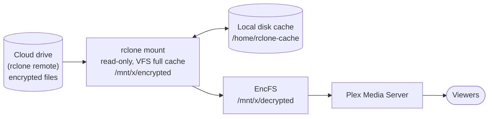

# plex-server

Scripts that turn a bare Ubuntu/Debian box into a Plex Media Server whose media
lives in the cloud — mounted with **rclone**, transparently decrypted with
**EncFS**, cached on local disk, and kept alive by cron — plus the day-to-day
tools for running it.

## How it fits together



- A separate machine (the "processing server") encrypts new media with EncFS and
  uploads it to the cloud drive. This box only ever **reads**.
- `rclone mount` exposes the encrypted cloud folder at `$ENC_DIR_LOCAL` and keeps
  every chunk it reads in a local cache (`--vfs-cache-mode full`, LRU up to
  `RCLONE_CACHE_MAX_SIZE`). Anything played once is served from disk after that,
  and seeks inside cached files are instant. New uploads show up within about a
  minute (`--poll-interval 1m`).
- EncFS mounts on top of that and presents plain filenames and content at
  `$DEC_DIR_LOCAL`. Plex's libraries point there.
- Cron keeps the mount healthy (`mount-check.sh` every few minutes), recycles it
  nightly (`cycle-mount.sh`), and remounts everything at boot.

## Layout

```
install.sh                 runs the setup/ steps in order
setup/
  00.bashrc.sh             interactive: writes .env, stores EncFS/rclone creds, hooks root's .bashrc
  01.dependencies.sh       apt packages, latest stable rclone (checksum-verified), fusermount3 shim
  02.os-settings.sh        network/sysctl tuning for many concurrent streams
  03.cron-jobs.sh          installs the cron schedule (idempotent)
  04.plex.sh               installs Plex (via plexupdate), extra media agent, sqlite cache tweak
  05.encryption.sh         mounts rclone, then EncFS on top (also the @reboot job)
scripts/
  mount.sh                 the rclone mount command (all flags live here)
  cycle-mount.sh           kill + restart the mount inside a detached screen session
  mount-check.sh           is the decrypted tree readable? if not, cycle the mount
  logs-cleanup.sh          nightly log truncation
  plex-scan.sh (+ .py)     scan one show/movie folder into Plex, fuzzy by name
  cache-status.sh          what's on local disk, per file, in decrypted names
  helper-functions.sh      encode/decode filenames with encfsctl (sourced by .bashrc)
addons/
  plexpy.sh                install PlexPy (now Tautulli) as a systemd service
  extended-personal-media-scanner.sh   scanner for libraries without standard metadata
```

Generated on the server, never committed: `.env` (paths and binaries), `logs/`,
and the credential files `.env` points at.

## Getting started

1. SSH in (forward 32400 so you can reach Plex's web UI at `http://localhost:32400/web` before Remote Access is set up):

   ```
   ssh -i ~/.ssh/id_rsa -L 32400:localhost:32400 root@<your.pms.public.ip>
   ```

2. Clone to `/plex-server` — the scripts assume that path:

   ```
   apt-get install -y git && cd / && git clone https://github.com/n8io/plex-server.git && cd plex-server
   ```

3. Run the installer and answer the prompts:

   ```
   ./install.sh
   ```

   You'll be asked for the remote folder that holds the encrypted media, where to
   mount things (default `/mnt/x`), your EncFS password, the contents of
   `encfs.xml` and of `rclone.conf` from the processing server. Existing values
   are kept if you press Enter.

4. In Plex (`Settings → Libraries`) add libraries under `$DEC_DIR_LOCAL`
   (e.g. `/mnt/x/decrypted/tv`, `/mnt/x/decrypted/movies`). In
   `Settings → Remote Access`, manually specify port 32400 — automatic port
   mapping doesn't work on a datacenter box.

### `.env`

`00.bashrc.sh` writes `/plex-server/.env`, which every script sources. The
important variables:

| Variable | Meaning | Default |
|---|---|---|
| `ENC_DIR_REMOTE` | folder on the rclone remote holding encrypted media | `/encrypted` |
| `MOUNT_DIR` | parent of the two mount points | `/mnt/x` |
| `ENC_DIR_LOCAL` / `DEC_DIR_LOCAL` | rclone mount / EncFS mount | `$MOUNT_DIR/encrypted`, `$MOUNT_DIR/decrypted` |
| `ENCFS_CREDS` / `ENCFS6_CONFIG` | EncFS password file / config | `/.encfs`, `/encfs.xml` |
| `RCLONE_BIN` | rclone binary | `/usr/sbin/rclone` |
| `RCLONE_CACHE_DIR` / `RCLONE_CACHE_MAX_SIZE` | local media cache (optional overrides) | `/home/rclone-cache`, `800G` |

`.env` also defines `log_info` / `log_error` / `log_fatal`, which write to
`logs/*.log`.

## Cron schedule

Installed by `03.cron-jobs.sh` (won't duplicate entries on re-run):

| When | Job | Why |
|---|---|---|
| `@reboot` | `setup/05.encryption.sh` | bring up rclone + EncFS after a restart |
| every 3 min | `scripts/mount-check.sh` | remount if the decrypted tree is empty |
| daily 08:01 UTC | `scripts/logs-cleanup.sh` | truncate logs |
| daily 09:02 UTC | `scripts/cycle-mount.sh` | fresh rclone process every day |

Plex itself updates through [plexupdate](https://github.com/mrworf/plexupdate),
which `04.plex.sh` installs; schedule it once (e.g. `30 6 * * * /opt/plexupdate/plexupdate.sh --config /etc/plexupdate.conf`).

## Day-to-day

All examples run from `/plex-server` (root's shell starts there).

### Get new media into Plex right away

```
scripts/plex-scan.sh -t alone                   # TV show, fuzzy name
scripts/plex-scan.sh -m super mario             # movie; ambiguous names prompt
scripts/plex-scan.sh game changer               # search every library
scripts/plex-scan.sh -f -t alone                # also refresh metadata of known episodes
scripts/plex-scan.sh "tv/adult/Alone/Season 13" # an explicit folder
scripts/plex-scan.sh -l -t gold                 # just list the matches
scripts/plex-scan.sh -n -y -m mutiny            # dry run, auto-pick best match
```

Scans **only that folder** (Plex's partial-refresh API), so it takes seconds
instead of a full library scan. Matching is done against the folders on the
mount, not Plex's database, so brand-new titles work. The server token is read
from Plex's own `Preferences.xml` at runtime. Hook it into the upload step on the
processing server and new episodes appear about a minute after they finish
uploading.

### See what's cached locally

```
scripts/cache-status.sh                         # everything in the cache
scripts/cache-status.sh "movies/release/Dune (2021)"
```

```
 cached       size  file
 100.0%    0.36 GB  tv/adult/Game Changer/Season 03/Game Changer - S03E09 ... .mkv
  37.3%    1.46 GB  movies/prerelease/The Super Mario Galaxy Movie (2026)/... .mkv
```

`100%` plays entirely from local disk. A partial figure is a file someone
started and stopped; the rest streams from the cloud on demand. To pre-warm a
title, read it once: `cat "/mnt/x/decrypted/movies/release/Dune (2021)/"*.mkv > /dev/null`.

### Mount maintenance

```
scripts/mount-check.sh        # health check (what cron runs); logs to logs/mount-check.log
scripts/cycle-mount.sh        # restart the rclone mount; EncFS stays mounted on top
setup/05.encryption.sh        # full remount of both layers
tail -f logs/rclone-mount-debug.log
```

`helper-functions.sh` (sourced into root's shell) gives you `encode <path>` and
`decode <path>` to translate between plain and encrypted filenames.

## Streaming performance notes

- Every stream that **Direct Plays** costs almost nothing; every transcode costs
  20–30 % of a CPU without hardware encoding. Keep the library H.264/AAC where
  possible, prefer text subtitles (image subtitles force a transcode), and have
  viewers enable Direct Play/Direct Stream and "Original" remote quality in their
  apps.
- `02.os-settings.sh` raises TCP buffers and file-descriptor limits for many
  simultaneous connections.
- Plex's transcoder temp directory should be `/dev/shm` (RAM).
- The first play of a file is limited by the cloud provider's per-file download
  speed; subsequent plays and seeks come from the local cache.

## Rollback and recovery

- **Mount problems** — `scripts/cycle-mount.sh`, then `setup/05.encryption.sh`
  if EncFS also dropped. `mount-check.sh` does the first automatically.
- **rclone upgrade regret** — install the previous binary at `$RCLONE_BIN` and
  cycle the mount; the cache directory can simply be deleted.
- **Plex data** — Plex keeps rolling copies of its database in
  `Plug-in Support/Databases/`. Back the whole `Plex Media Server` directory up
  off-box; the media itself is already in the cloud.

## Gotchas

- rclone ≥ 1.60 execs `fusermount3`. `01.dependencies.sh` creates a
  `fusermount3 → fusermount` symlink on FUSE 2-only hosts; if a fresh mount fails
  with "executable file not found", that's why.
- Plex's data directory is set by `PLEX_MEDIA_SERVER_APPLICATION_SUPPORT_DIR` in
  the systemd unit. Never edit `/lib/systemd/system/plexmediaserver.service`
  directly — `.deb` upgrades overwrite it. Put overrides in
  `/etc/systemd/system/plexmediaserver.service.d/override.conf`
  (`TimeoutStopSec=600` there is also a good idea: Plex can take minutes to
  checkpoint a large database on stop, and a SIGKILL mid-write corrupts it).
- `mount.sh` uses `--allow-non-empty` so a lazily-unmounted directory doesn't
  block the remount; a stale mount therefore looks like an empty tree, which is
  what `mount-check.sh` tests for.
- The rclone mount is read-only by design. Plex features that write next to the
  media (Optimize, subtitle downloads into the media folder) won't work.
